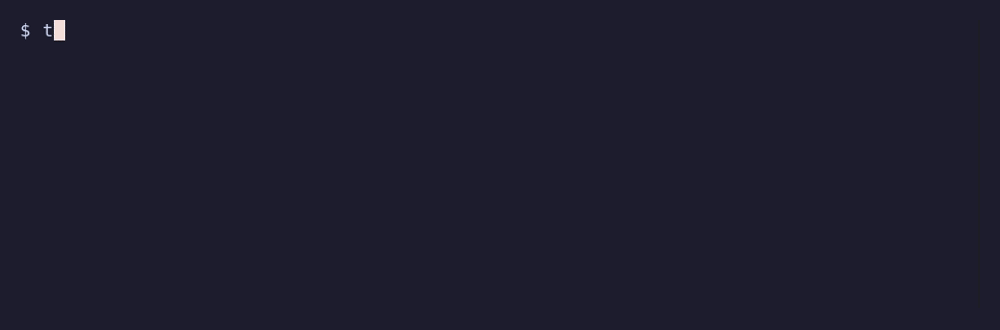

# blast-radius

[](https://github.com/SandeepKomal/blast-radius/actions/workflows/ci.yml)
[](https://github.com/SandeepKomal/blast-radius/releases)
[](LICENSE)

A Claude Code hook that shows you what a `terraform apply`, `kubectl delete` or `helm uninstall`
will destroy before the agent runs it, and blocks it in production.



The preview comes from the tool itself (`terraform plan`, `kubectl get`, `kubectl diff`), so you
see the real list of resources, not a guess based on the command text. Reads, plans and applies
with no changes go through untouched. Databases, buckets, volumes, PVCs and namespaces are marked
`(holds data)`.

- **Fails closed.** A preview that can't run, a broken config, a crash or a timeout never lets a
  command through silently.
- **Follows the whole command line.** `terraform workspace select prod && terraform destroy` is
  judged against `prod`; so are `cd`, `export`, `kubectl config use-context` and `sh -c`.
- **Can't be switched off by the agent.** Uninstalling it or editing its settings needs your
  approval, and a repository's config can only make rules stricter.
- **One static binary, standard library only, nothing leaves your machine.**

## Install

Download the archive for your platform from the
[releases page](https://github.com/SandeepKomal/blast-radius/releases) and put `blast-radius` on
your `PATH`. Every release archive has signed build provenance, which you can check with the
[GitHub CLI](https://cli.github.com):

```bash
gh attestation verify blast-radius_*_linux_amd64.tar.gz --repo SandeepKomal/blast-radius
```

Or build it with Go 1.24 or later:

```bash
go install github.com/sandeepkomal/blast-radius@latest
```

Then add the hook and check the setup:

```bash
blast-radius install    # adds the hook to ~/.claude/settings.json
blast-radius doctor     # checks the hook, config and tools, and runs a self-test
```

Restart Claude Code to load the hook. Use `blast-radius install --project` to add it to a
repository's `.claude/settings.json` instead. `blast-radius uninstall` removes it. Claude Code
v2.1.295 or later is needed for fail-closed hooks (`onFailure: "block"`).

## Try it without a cloud account

`examples/demo` is a Terraform project made of `terraform_data` resources, so it needs no cloud
account and downloads no providers:

```bash
cd examples/demo
terraform init && terraform apply -auto-approve
blast-radius check terraform destroy            # needs approval
terraform workspace new prod && terraform apply -auto-approve
blast-radius check terraform destroy            # blocked
```

Or ask your agent to "tear down the demo infrastructure" and watch the hook step in.

## What it covers

| Tool | Previewed | Recognised (no preview) |
| --- | --- | --- |
| Terraform, OpenTofu | `apply`, `destroy`, `apply -destroy`, `apply <planfile>` | `state rm/push/mv`, `workspace delete`, `taint`, `import`, `force-unlock` |
| Terragrunt | `apply`, `destroy` in one module | `run-all`/`--all` (treated as destructive) |
| kubectl, oc | `delete` (every matched object; namespaces include their contents), `apply` incl. `--prune` | `drain`, `scale --replicas=0`, `replace --force`, `rollout restart/undo`, `patch`, `edit`, `create`, `label` |
| Helm | `uninstall` (every object the release owns) | `upgrade`, `install`, `rollback` |
| Pulumi | | `destroy`, `up`, `stack rm`, `state delete` (rated against the selected stack) |
| AWS CLI | | `delete-*`, `terminate-*`, `remove-*`, `deregister-*`, `s3 rm/rb`, `s3 sync --delete`, and changes such as `create-*`, `put-*`, `update-*` |
| gcloud, gsutil | | `delete`, `rm`, `rb`, `rsync -d`, and changes such as `create`, `deploy`, `update` |
| Azure CLI | | `delete`, `purge`, and changes such as `create`, `update`, `restart` |

`--dry-run` commands are left alone. On Windows the hook also covers Claude Code's PowerShell
tool, with PowerShell quoting rules.

"Recognised" means blast-radius knows the command deletes or changes things but can't list what,
so it is rated on what the command does: deletions ask by default and are blocked in production.

## Policy

Out of the box:

| | create / update | delete / replace |
| --- | --- | --- |
| anywhere | pass | ask |
| production (`*prod*`, `*prd*`) | ask | deny |

The environment is matched against the Terraform workspace, kube context and namespace, cloud
profile or project, and working directory. You can add environments, protect specific
resources so they are never deleted, mark your own resource types as holding data, and keep an
audit log:

```json
{
  "$schema": "https://raw.githubusercontent.com/SandeepKomal/blast-radius/main/docs/config.schema.json",
  "environments": [
    { "name": "production", "match": ["*prod*", "arn:aws:eks:*:123456789012:*"], "change": "ask", "destroy": "deny" },
    { "name": "sandbox", "match": ["kind-*", "minikube"], "destroy": "pass" }
  ],
  "protect": ["aws_db_instance.*", "*/persistentvolumeclaim/*"],
  "audit_log": "~/.local/state/blast-radius/audit.jsonl"
}
```

Put it in your user config (`blast-radius init --user`) or in a repository's
`.blast-radius.json` (`blast-radius init`). A repository's file can only make decisions
stricter, so an agent can't relax the rules by writing one. See
[docs/configuration.md](docs/configuration.md) for every option.

## Without Claude Code

`blast-radius check` runs the same analysis in a script, a CI job or another agent's hook. It
exits 0 when the command can run, 10 when it needs approval and 20 when it is blocked.

```bash
blast-radius check -C infra 'terraform apply -auto-approve'
blast-radius check --json 'kubectl delete ns payments'
blast-radius check --shell powershell '$env:TF_WORKSPACE = "prod"; terraform destroy'
```

## How it works

For each shell command or file edit the agent wants to make, the hook parses the command line,
follows `cd`, exports and context switches, runs a read-only preview of each infrastructure
command with the same flags and context, rates it, and applies your policy. It answers `ask` or
`deny` with the preview, or prints nothing so your usual permission rules apply. Previews never
take state locks and are killed, with their child processes, when they run out of time.

The details, including what happens when something goes wrong, are in
[docs/how-it-works.md](docs/how-it-works.md).

## Limitations

blast-radius guards against mistakes, not against an agent deliberately working around it.

- It sees commands the agent runs through the shell. A script it runs (`make deploy`,
  `./teardown.sh`, `python cleanup.py`), a cloud SDK call or a tool it doesn't know isn't
  previewed.
- `helm upgrade`, Pulumi and the cloud CLIs are recognised by their verbs, not previewed.
- Terraform previews need an initialised working directory and credentials that can run
  `plan`; without them the command is treated as destructive.
- Remote Terraform runs that can't save a local plan file (some Terraform Cloud setups) can't be
  previewed and are treated as destructive.

Keep using least-privilege credentials for anything that matters.

## Roadmap

- Hooks for Codex, Cursor, Gemini CLI and OpenCode
- Previews for `helm upgrade` (via `helm diff`) and `pulumi up` (via `pulumi preview`)
- SQL `DROP`/`TRUNCATE` and `docker system prune`
- A shareable HTML report of what depends on each deleted resource

## Contributing

Bug reports with the exact command are the most useful thing you can send:
`blast-radius check --json '<command>'` shows what was decided and why. See
[CONTRIBUTING.md](CONTRIBUTING.md). If a destructive command gets through without approval,
please report it privately as described in [SECURITY.md](SECURITY.md).

## License

[MIT](LICENSE)
