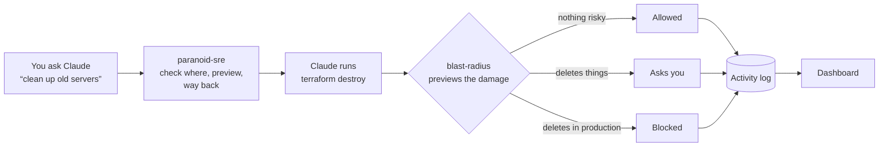
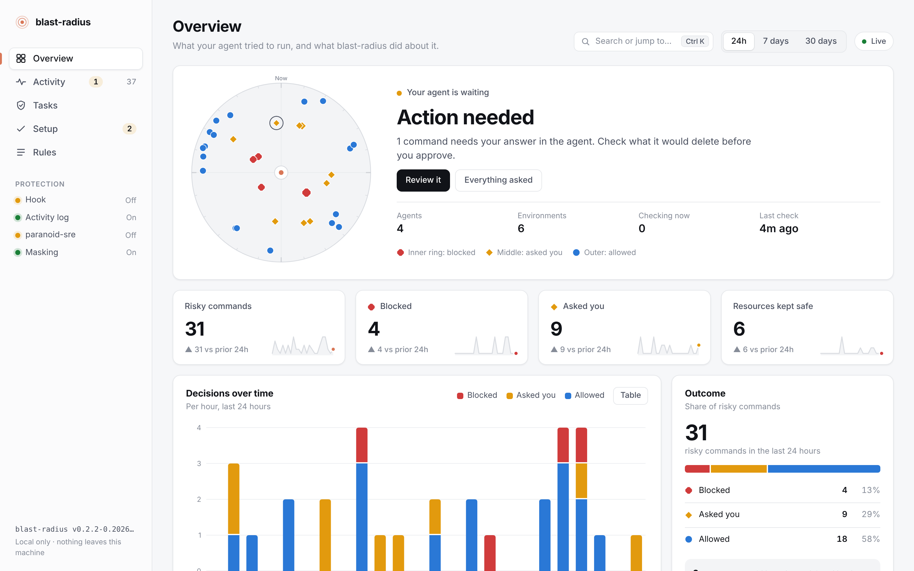
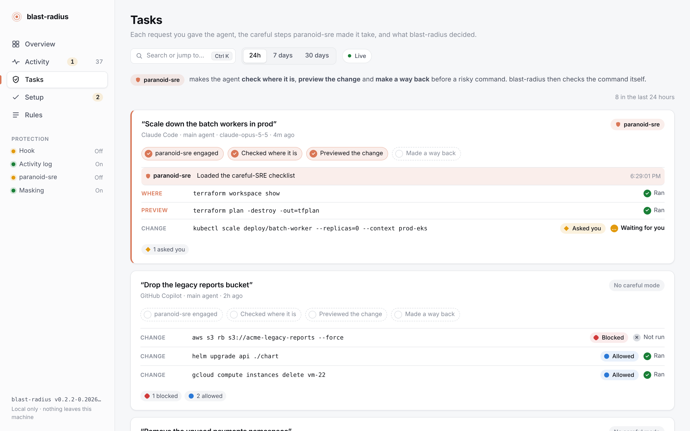
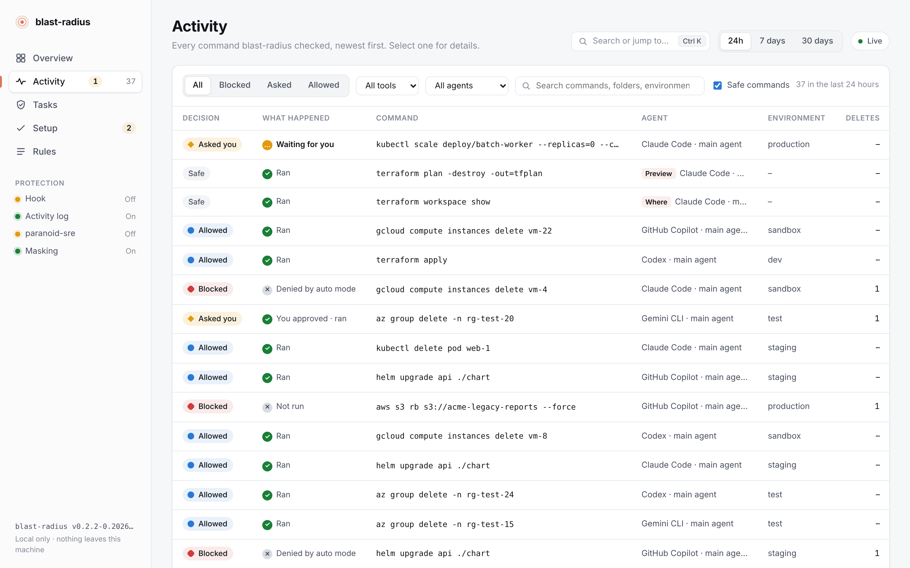
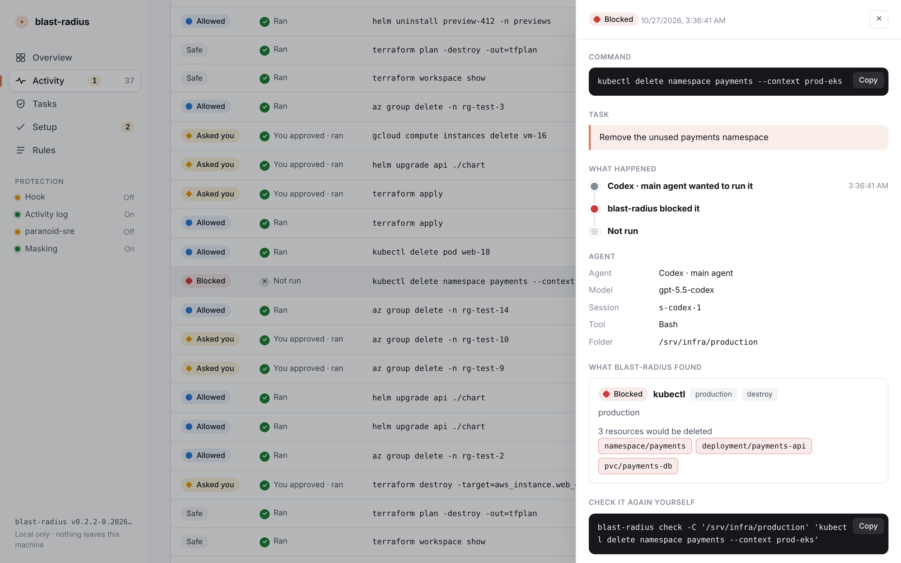
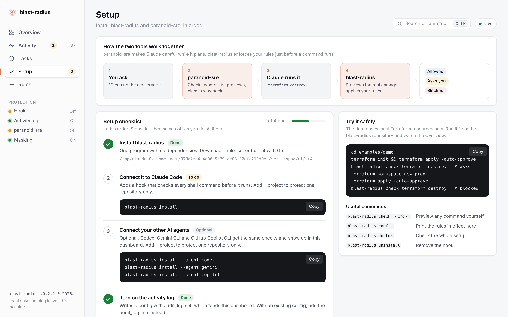
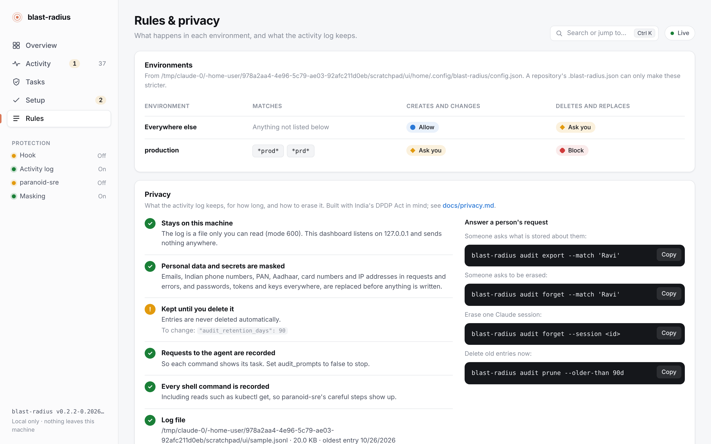
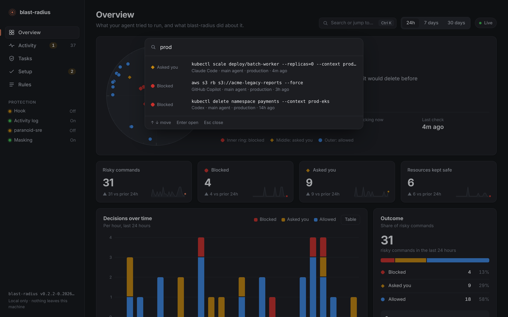
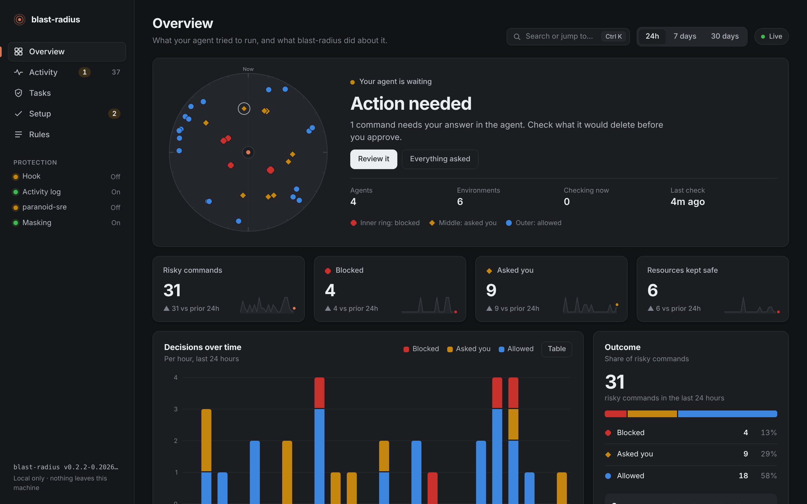
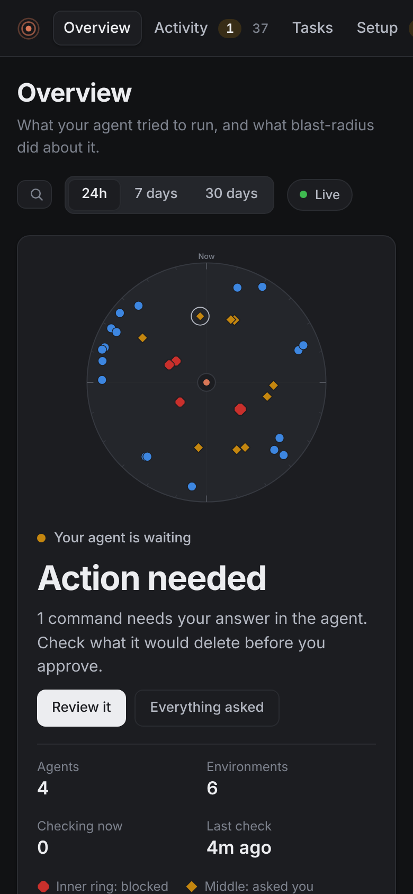

# blast-radius

[](https://github.com/SandeepKomal/blast-radius/actions/workflows/ci.yml)
[](https://github.com/SandeepKomal/blast-radius/releases)
[](LICENSE)
[](https://github.com/SandeepKomal/blast-radius/actions/workflows/github-code-scanning/codeql)
[](https://scorecard.dev/viewer/?uri=github.com/SandeepKomal/blast-radius)

**See what your AI agent is about to destroy, before it does.** blast-radius is a hook for Claude Code, Codex, Gemini CLI and GitHub Copilot CLI that previews what a `terraform apply`, `kubectl delete` or `helm uninstall` would delete,
asks you first, and blocks it in production. A local dashboard shows everything your agent
ran, which agent and model ran it, for which task, and what happened.


## In one minute

AI coding agents can run infrastructure commands. One wrong `terraform destroy` in the wrong
workspace can take down production. Two tools stop that:

| | [paranoid-sre](https://github.com/SandeepKomal/paranoid-sre) | **blast-radius** (this repository) |
| --- | --- | --- |
| What it is | A skill: instructions Claude follows | A hook: a program Claude Code runs before every command |
| When it acts | While Claude plans | Just before a command runs |
| What it does | Makes Claude check where it is, preview the change and plan a way back | Previews the real damage with the tool itself, then allows, asks you or blocks |
| Can Claude skip it? | It follows it like any instruction | No |



- **Real previews, not guesses.** The list of resources comes from `terraform plan`,
  `kubectl get`, `kubectl diff` and `helm get manifest`. Databases, buckets, volumes, PVCs and
  namespaces are marked `(holds data)`.
- **Fails closed.** A preview that can't run, a broken config, a crash or a timeout never lets a
  command through silently.
- **Follows the whole command line.** `terraform workspace select prod && terraform destroy` is
  judged against `prod`; so are `cd`, `export`, `kubectl config use-context` and `sh -c`.
- **Can't be switched off by the agent.** Uninstalling it or editing its settings needs your
  approval, and a repository's config can only make rules stricter.
- **Private by design.** One static binary, standard library only. Nothing leaves your machine,
  and personal data is masked in the activity log ([privacy and DPDP](docs/privacy.md)).

## Contents

- [Screenshots](#screenshots)
- [Install, step by step](#install-step-by-step)
- [Try it without a cloud account](#try-it-without-a-cloud-account)
- [Using the dashboard](#using-the-dashboard)
- [What it covers](#what-it-covers)
- [Policy](#policy)
- [Privacy and India's DPDP Act](#privacy-and-indias-dpdp-act)
- [Commands](#commands)
- [How it works](#how-it-works) · [Limitations](#limitations) · [Roadmap](#roadmap)
- [Trust and security](#trust-and-security)
- [Contributing](#contributing) · [Code of conduct](#code-of-conduct) · [License](#license)

## Screenshots

Screenshots use sample data. Click any image for full resolution.

**Overview**: a radar of every risky command (blocked in the inner ring, asked in the middle,
allowed outside; the angle is when it ran) next to a plain-words status and what to do next. Below
it: decisions over time, how carefully the agent worked (paranoid-sre), which agents and models
ran commands, and what is waiting for you right now.

[](docs/screenshots/overview.png)

**Tasks**: each request you gave the agent, the careful steps paranoid-sre made it take, the
risky command, blast-radius's decision and the result.

[](docs/screenshots/tasks.png)

**Activity**: every command, what blast-radius decided and what happened next.

[](docs/screenshots/activity.png)

**Details**: select any command for its task, a timeline from request to result, the agent,
model and session, and exactly what it would have deleted.

[](docs/screenshots/details.png)

**Setup**: the steps below, ticking themselves off as you complete them.

[](docs/screenshots/setup.png)

**Rules and privacy**: the policy in effect, protected resources, and what the activity log
keeps, for how long, and how to erase it.

[](docs/screenshots/rules-privacy.png)

**Search and jump**: press <kbd>Ctrl</kbd>+<kbd>K</kbd> (<kbd>⌘</kbd>+<kbd>K</kbd> on a Mac) or
<kbd>/</kbd> to jump to a page or find any command by its text, agent or environment.

[](docs/screenshots/palette.png)

<table>
<tr>
<td width="68%"><a href="docs/screenshots/overview-dark.png"></a><br><b>Dark mode</b> follows your system setting.</td>
<td width="32%"><a href="docs/screenshots/mobile.png"></a><br><b>Phone</b> layout.</td>
</tr>
</table>

## Install, step by step

You need [Claude Code](https://code.claude.com) v2.1.295 or later (for fail-closed hooks).
Each step below shows up in the dashboard's **Setup** page and ticks itself off.

### 1. Install the blast-radius program

**Option A, download (no Go needed).** Get the archive for your system from the
[releases page](https://github.com/SandeepKomal/blast-radius/releases), unpack it and put
`blast-radius` on your `PATH`:

```bash
# macOS (Apple silicon) example; pick the archive for your OS and CPU
tar -xzf blast-radius_*_darwin_arm64.tar.gz
sudo mv blast-radius /usr/local/bin/
```

On Windows, unzip `blast-radius_*_windows_amd64.zip` and put `blast-radius.exe` in a folder on
your `PATH`. Every archive has signed build provenance, which you can check with the
[GitHub CLI](https://cli.github.com):

```bash
gh attestation verify blast-radius_*_darwin_arm64.tar.gz --repo SandeepKomal/blast-radius
```

**Option B, build with Go 1.24 or later.**

```bash
go install github.com/sandeepkomal/blast-radius@latest
```

Check it works: `blast-radius version`.

### 2. Connect it to Claude Code

```bash
blast-radius install
```

This adds the hook to `~/.claude/settings.json` (all your projects). Use
`blast-radius install --project` to protect one repository only, through its
`.claude/settings.json`. If you installed an older version, run it again: it adds the hooks
that record which agent ran a command and whether it ran.

### Using another AI agent: Codex, Gemini CLI, GitHub Copilot CLI

The same checks, policy and dashboard work for these agents. Install the hook for each agent
you use:

```bash
blast-radius install --agent codex     # ~/.codex/hooks.json
blast-radius install --agent gemini    # ~/.gemini/settings.json
blast-radius install --agent copilot   # ~/.copilot/hooks/blast-radius.json
```

Add `--project` to protect one repository instead (`.codex/hooks.json`,
`.gemini/settings.json` or `.github/hooks/blast-radius.json`), and use `uninstall` with the
same flags to remove it. Each hook checks shell commands and file edits, and the dashboard shows
which agent ran each command.

| | Codex | Gemini CLI | GitHub Copilot CLI |
| --- | --- | --- | --- |
| Tested with | 0.164.0 | 0.65.0 | 1.0.104 |
| Checks | `Bash`, `apply_patch` | `run_shell_command`, `write_file`, `replace` | `bash`/`powershell`, `edit`, `create` |
| When a command needs approval | Blocked: Codex hooks can't ask | Blocked: Gemini CLI hooks can't ask | Copilot asks you; blocked in `-p`, autopilot and the cloud agent |
| Records for the dashboard | Commands, model, sessions, requests, results | Commands, sessions | Commands, sessions, subagents |
| If the hook can't run | Codex runs the command | Gemini CLI runs the command | Copilot blocks the command |

**Codex: trust the hooks.** Codex doesn't run a hook until you trust it. After installing,
start Codex, open `/hooks` and trust the blast-radius hooks. Codex asks again whenever the hook
changes, for example after `blast-radius install` moves it to a new binary. An untrusted hook is
skipped without any warning, and commands run unchecked.

Codex and Gemini CLI let a command run when the hook can't start, so `install` writes the full
path of the binary rather than relying on the agent's `PATH`. After moving the binary, run
`install` again. `blast-radius doctor` checks that each agent's hook points at a binary that
exists. Previews are capped well inside the hook timeout, so a slow preview ends in a decision
and never in a timeout.

**Any other agent.** If an agent can run a command before each tool call, have it call
`blast-radius check --agent NAME`. It exits 0 when the command can run, 10 when it needs
approval and 20 when it is blocked, and the command appears in the dashboard under that
agent's name:

```bash
blast-radius check --agent aider --session "$SESSION_ID" -C "$PWD" "$COMMAND"
```

### 3. Turn on the activity log

```bash
blast-radius init --user
```

This writes your user config with the activity log on, every command recorded, personal data
masked and entries kept for 90 days. The dashboard reads this log. Already have a config? Add:

```json
"audit_log": "~/.local/state/blast-radius/audit.jsonl",
"audit_all": true,
"audit_retention_days": 90
```

### 4. Add paranoid-sre

```bash
claude plugin marketplace add SandeepKomal/paranoid-sre
claude plugin install paranoid-sre@paranoid-sre
```

Codex, Gemini CLI and GitHub Copilot CLI all read skills from `~/.agents/skills`:

```bash
git clone https://github.com/SandeepKomal/paranoid-sre
mkdir -p ~/.agents/skills && cp -r paranoid-sre/skills/paranoid ~/.agents/skills/
```

### 5. Check everything, then restart Claude Code

```bash
blast-radius doctor
```

`doctor` checks the hook, the config and your tools, and runs a self-test. Then restart Claude
Code so it loads the new hooks and plugin.

### 6. Open the dashboard

```bash
blast-radius ui
```

Open <http://127.0.0.1:7357>. Keep the terminal open while you work; press Ctrl+C to stop.
Use `--addr 127.0.0.1:8080` for another port.

**To remove blast-radius:** `blast-radius uninstall` (add `--project` if you installed it
there). Your config and activity log are left in place; delete them if you don't need them.

## Try it without a cloud account

`examples/demo` is a Terraform project made of `terraform_data` resources, so it needs no cloud
account and downloads no providers:

```bash
cd examples/demo
terraform init && terraform apply -auto-approve
blast-radius check terraform destroy            # needs approval
terraform workspace new prod && terraform apply -auto-approve
blast-radius check terraform destroy            # blocked
```

Or ask Claude to "tear down the demo infrastructure" and watch it appear in the dashboard.

## Using the dashboard

| Page | What it answers |
| --- | --- |
| **Overview** | What needs you right now, and a radar of every risky command: select a blip for its details. How many risky commands ran, how many were blocked or asked about, how many resources were kept safe, whether paranoid-sre was used, which agents did what, and what is waiting for you right now. The range switch shows 24 hours, 7 days or 30 days. |
| **Activity** | Every command, filterable by result, tool and text. Select one for details. |
| **Tasks** | Each request you gave Claude, as a story from your words to the result. |
| **Setup** | The install steps above, with live status. |
| **Rules & privacy** | The policy in effect and what the activity log keeps. |

**Decision**: what blast-radius decided before the command ran.

| | Meaning |
| --- | --- |
| 🔴 Blocked | Not allowed by your policy (for example, a delete in production). Claude is told not to retry. |
| 🔶 Asked you | It deletes or changes something, so Claude Code asked you. |
| 🔵 Allowed | It changes things your policy allows. |
| Safe | Nothing risky found (reads, plans, `get`, `list`). |

**What happened**: what happened after the decision.

| | Meaning |
| --- | --- |
| ✓ Ran / You approved · ran | It ran. For "Asked you", that means you said yes. |
| ! Failed | It ran and exited with an error (shown in the details). |
| … Waiting for you | Claude Code is waiting for your answer right now. |
| ✕ Not run | Blocked, or you declined. Claude Code doesn't report a "no", so an asked command with no result after 15 minutes is shown as not run. |

**Careful mode (paranoid-sre)**: for each task, the dashboard shows whether Claude loaded
paranoid-sre and which of its steps it took before the risky command:

| Step | Recognised from commands such as |
| --- | --- |
| Checked where it is | `kubectl config current-context`, `terraform workspace show`, `aws sts get-caller-identity`, `gcloud config list`, `az account show` |
| Previewed the change | `terraform plan`, `kubectl diff`, `--dry-run`, `helm get manifest`, `pulumi preview`, `blast-radius check` |
| Made a way back | snapshots, backups, `terraform state pull`, `kubectl get … -o yaml > backup.yaml`, `pg_dump` |

These read-only steps are only recorded with `"audit_all": true`, which `init --user` sets.

The dashboard listens only on `127.0.0.1`, only reads files, and loads nothing from the
internet.

## What it covers

| Tool | Previewed | Recognised (no preview) |
| --- | --- | --- |
| Terraform, OpenTofu | `apply`, `destroy`, `apply -destroy`, `apply <planfile>` | `state rm/push/mv`, `workspace delete`, `taint`, `import`, `force-unlock` |
| Terragrunt | `apply`, `destroy` in one module | `run-all`/`--all` (treated as destructive) |
| kubectl, oc | `delete` (every matched object; namespaces include their contents), `apply` incl. `--prune` | `drain`, `scale --replicas=0`, `replace --force`, `rollout restart/undo`, `patch`, `edit`, `create`, `label` |
| Helm | `uninstall` (every object the release owns) | `upgrade`, `install`, `rollback` |
| Pulumi | | `destroy`, `up`, `stack rm`, `state delete` (rated against the selected stack) |
| AWS CLI | | `delete-*`, `terminate-*`, `remove-*`, `deregister-*`, `s3 rm/rb`, `s3 sync --delete`, and changes such as `create-*`, `put-*`, `update-*` |
| gcloud, gsutil | | `delete`, `rm`, `rb`, `rsync -d`, and changes such as `create`, `deploy`, `update` |
| Azure CLI | | `delete`, `purge`, and changes such as `create`, `update`, `restart` |

`--dry-run` commands are left alone. On Windows the hook also covers Claude Code's PowerShell
tool, with PowerShell quoting rules.

"Recognised" means blast-radius knows the command deletes or changes things but can't list what,
so it is rated on what the command does: deletions ask by default and are blocked in production.

## Policy

Out of the box:

| | create / update | delete / replace |
| --- | --- | --- |
| anywhere | allow | ask |
| production (`*prod*`, `*prd*`) | ask | block |

The environment is matched against the Terraform workspace or Pulumi stack, kube context and
namespace, AWS profile and account, gcloud project, Azure subscription and resource group, and
working directory. Names without `prod` in them can be added, so a production cluster called
`eks-main` or a whole AWS account is protected too. You can also protect specific resources so
they are never deleted, and mark your own resource types as holding data:

```json
{
  "$schema": "https://raw.githubusercontent.com/SandeepKomal/blast-radius/main/docs/config.schema.json",
  "environments": [
    { "name": "production", "match": ["*prod*", "eks-main", "123456789012", "arn:aws:eks:*:123456789012:*"], "change": "ask", "destroy": "deny" },
    { "name": "sandbox", "match": ["kind-*", "minikube"], "destroy": "pass" }
  ],
  "protect": ["aws_db_instance.*", "*/persistentvolumeclaim/*"],
  "audit_log": "~/.local/state/blast-radius/audit.jsonl",
  "audit_all": true,
  "audit_retention_days": 90
}
```

Put it in your user config (`blast-radius init --user`) or in a repository's
`.blast-radius.json` (`blast-radius init`). A repository's file can only make decisions
stricter, so an agent can't relax the rules by writing one. Every option is in
[docs/configuration.md](docs/configuration.md).

## Privacy and India's DPDP Act

blast-radius sends nothing anywhere. The activity log is a file on your machine that only you
can read, and it is off until you turn it on. When it is on:

- **Masked by default:** emails, Indian phone numbers, PAN, Aadhaar, card numbers and IP
  addresses in requests and errors, and passwords, tokens and keys everywhere, are replaced
  before anything is written (`audit_redact`).
- **Kept only as long as needed:** `audit_retention_days` deletes old entries automatically.
- **Access and erasure on request:** `blast-radius audit export --match 'Ravi'` shows what is
  stored about someone; `blast-radius audit forget --match 'Ravi'` erases it.
- **Less if you want it:** `"audit_prompts": false` stops recording what people type to the
  agent; commands, decisions and results are still recorded.

[docs/privacy.md](docs/privacy.md) lists every field the log can hold and has a checklist that
maps each DPDP Act and DPDP Rules obligation to a blast-radius feature or to what your
organisation does, plus a notice you can give your team.

## Commands

| Command | What it does |
| --- | --- |
| `blast-radius install [--agent claude\|codex\|gemini\|copilot] [--project]` | Add the hooks to an agent (default Claude Code) |
| `blast-radius uninstall [--agent ...] [--project]` | Remove them |
| `blast-radius doctor` | Check the hook, config and tools, and run a self-test |
| `blast-radius init [--user]` | Write a starter config (a repository's, or yours) |
| `blast-radius config` | Print the policy in effect here |
| `blast-radius ui [--addr host:port]` | Open the dashboard |
| `blast-radius check [-C dir] [--json] '<command>'` | Preview a command yourself |
| `blast-radius check --agent NAME [--session ID] '<command>'` | Check and record a command for an agent without a built-in hook |
| `blast-radius audit prune [--older-than 30d]` | Delete old activity log entries |
| `blast-radius audit export --match TEXT \| --session ID` | Print matching entries (access requests) |
| `blast-radius audit forget --match TEXT \| --session ID` | Delete matching entries (erasure requests) |

`blast-radius check` also works without Claude Code, in a script, a CI job or another agent's
hook. It exits 0 when the command can run, 10 when it needs approval and 20 when it is blocked:

```bash
blast-radius check -C infra 'terraform apply -auto-approve'
blast-radius check --json 'kubectl delete ns payments'
blast-radius check --shell powershell '$env:TF_WORKSPACE = "prod"; terraform destroy'
```

## How it works

For each shell command or file edit the agent wants to make, the hook parses the command line,
follows `cd`, exports and context switches, runs a read-only preview of each infrastructure
command with the same flags and context, rates it, and applies your policy. It answers `ask` or
`deny` with the preview, or prints nothing so your usual permission rules apply. Previews never
take state locks and are killed, with their child processes, when they run out of time.

The same program is also installed for a few other Claude Code events (session start, your
request, the command's result, skills loaded). For those it only writes to the activity log; it
never prints anything and can never block.

The details, including what happens when something goes wrong, are in
[docs/how-it-works.md](docs/how-it-works.md).

## Limitations

blast-radius guards against mistakes, not against an agent deliberately working around it.

- It sees commands the agent runs through the shell. A script it runs (`make deploy`,
  `./teardown.sh`, `python cleanup.py`), a cloud SDK call or a tool it doesn't know isn't
  previewed.
- `helm upgrade`, Pulumi and the cloud CLIs are recognised by their verbs, not previewed.
- Terraform previews need an initialised working directory and credentials that can run
  `plan`; without them the command is treated as destructive.
- Remote Terraform runs that can't save a local plan file (some Terraform Cloud setups) can't be
  previewed and are treated as destructive.
- Claude Code doesn't tell hooks when you decline a permission prompt, so the dashboard infers
  "not run" from the missing result.
- paranoid-sre's steps are recognised from the commands Claude runs; a check it does some other
  way isn't shown.

Keep using least-privilege credentials for anything that matters.

## Roadmap

- Hooks for Cursor, Windsurf, Cline and OpenCode (until then, `blast-radius check --agent`)
- Previews for `helm upgrade` (via `helm diff`) and `pulumi up` (via `pulumi preview`)
- SQL `DROP`/`TRUNCATE` and `docker system prune`
- A shareable HTML report of what depends on each deleted resource

## Contributing

Bug reports with the exact command are the most useful thing you can send:
`blast-radius check --json '<command>'` shows what was decided and why. See
[CONTRIBUTING.md](CONTRIBUTING.md) for development, and [CLAUDE.md](CLAUDE.md) for the rules
AI agents (and people) follow when changing this repository.

## Trust and security

blast-radius sits between an AI agent and your infrastructure, so it has to be trustworthy
itself. Every item below is checked automatically on every pull request or release.

**The program**

- [x] Fails closed: errors, crashes, timeouts and bad config end in "ask" or a block, never a
      silent pass (tests prove each path).
- [x] Previews are read-only and never take state locks.
- [x] Standard library only: no third-party Go dependencies to compromise.
- [x] No network access of its own: no telemetry, no update checks. The dashboard listens on
      `127.0.0.1` only, rejects other `Host` headers (DNS rebinding), sends a strict Content
      Security Policy, loads nothing from the internet and only reads files.
- [x] The agent can't switch it off: uninstalling or editing its settings needs your approval,
      and a repository's config can only make rules stricter.
- [x] The activity log is created with mode 600, secrets and personal data are masked, and
      retention and erasure are built in ([privacy](docs/privacy.md)).

**The code and the releases**

- [x] **CodeQL** code scanning on every pull request (Go, GitHub Actions, JavaScript).
- [x] **govulncheck** checks for known vulnerabilities in Go and the standard library.
- [x] **gitleaks** scans the full git history for committed secrets in CI.
- [x] **Dependabot** keeps GitHub Actions and Go modules up to date.
- [x] **OpenSSF Scorecard** rates the project's supply-chain practices weekly (badge above).
- [x] Every GitHub Action is pinned to a full commit SHA; workflows run with read-only tokens by
      default and don't keep credentials in the checkout; downloaded tools are verified against
      their published SHA-256 checksums.
- [x] Tests run on Linux, macOS and Windows with the race detector, plus fuzzing of the shell
      parser and end-to-end tests against real Terraform, OpenTofu, Helm, Pulumi and Kubernetes.
- [x] Release archives come with checksums and **signed build provenance**:

```bash
gh attestation verify blast-radius_*_linux_amd64.tar.gz --repo SandeepKomal/blast-radius
sha256sum -c checksums.txt --ignore-missing
```

**Reporting a problem:** if a destructive command gets through without approval, or a secret
reaches the activity log, report it privately as described in [SECURITY.md](SECURITY.md). You
get an acknowledgement within 3 days.

## Code of conduct

Everyone taking part follows the [code of conduct](CODE_OF_CONDUCT.md) (Contributor Covenant
2.1).

## License

[MIT](LICENSE): free to use, change and share, including commercially, as long as the
copyright notice stays with it.
